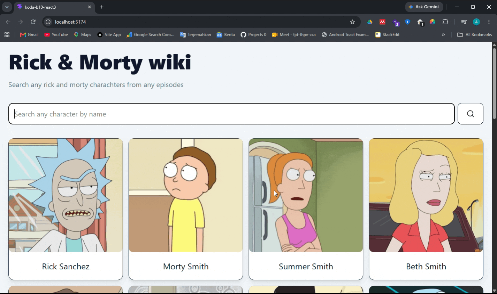

# React 3
on this repo i learn to create a simpel rick and morty wiki
using api from rickandmortyapi.com, then use react component to split 
a few section to be single item that can be reused

### result

